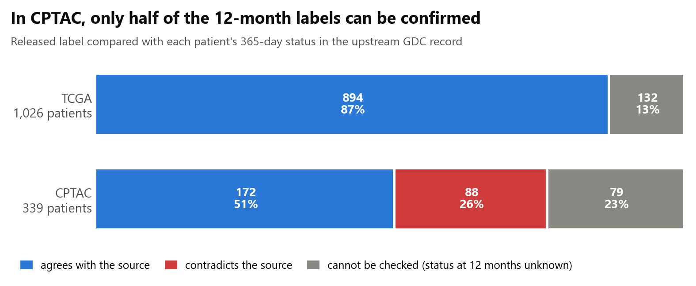
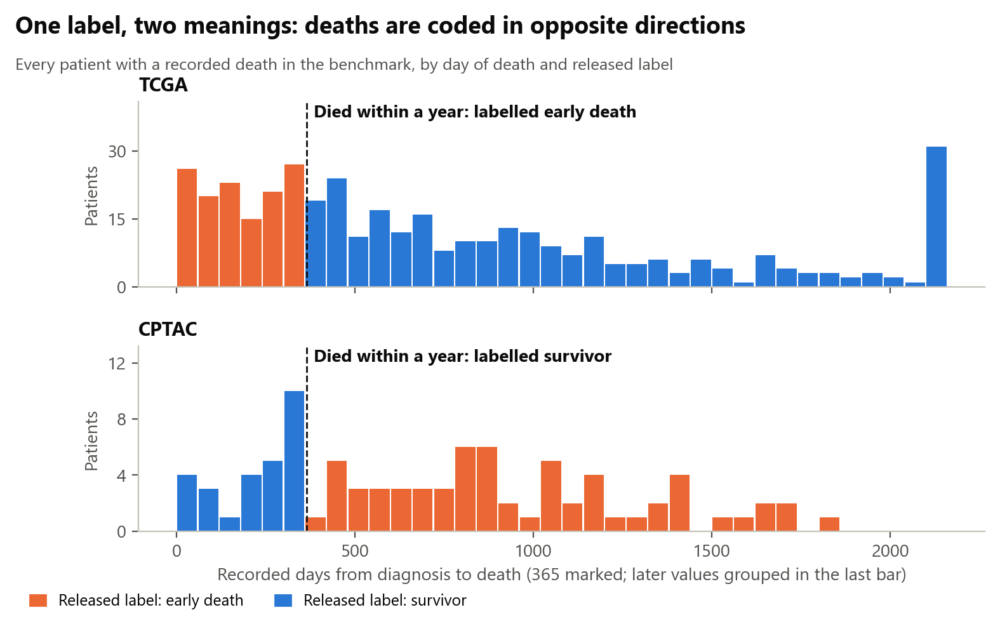
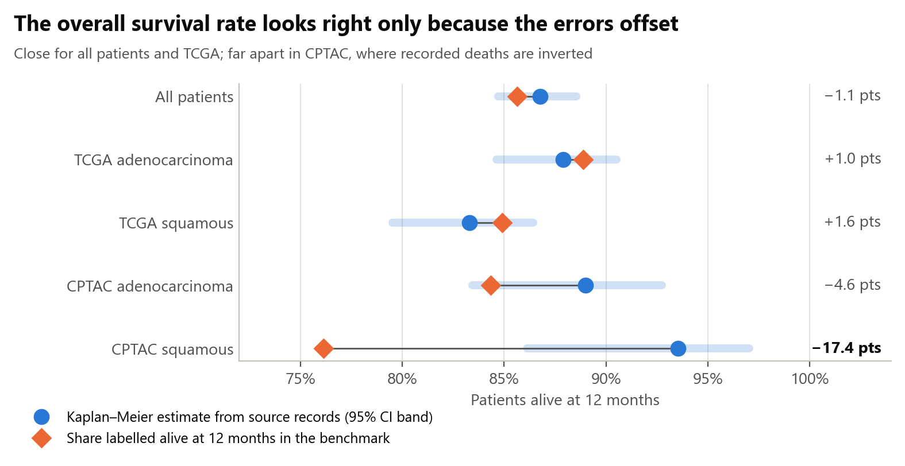
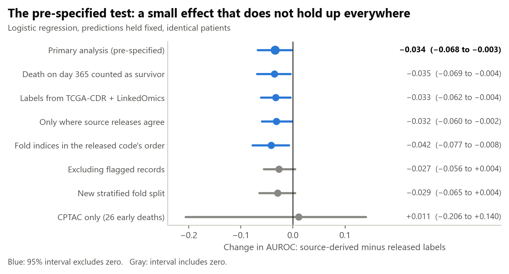
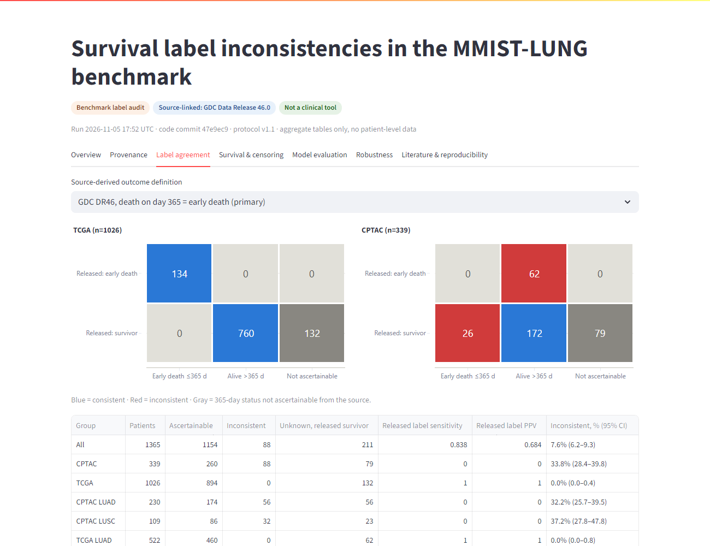

# Survival Label Inconsistencies and Machine Learning Evaluation in Lung Cancer

**A source-linked reanalysis of the MMIST-LUNG benchmark: when one survival label means two opposite things.**

**Omoding Isaac**, Data Scientist · [omodingisaac111@gmail.com](mailto:omodingisaac111@gmail.com) · [GitHub](https://github.com/Isaac25-lgtm)


MMIST-LUNG [[1]](#ref-1) is a public multimodal benchmark of 1,365 lung cancer patients from TCGA and CPTAC, with 12-month overall survival as a headline task. We traced every released label to the patient's upstream clinical record. In TCGA, every label that could be checked agreed. In CPTAC:

- **All 62 patients labelled as dying within a year were alive at day 365.** They died later.
- **All 26 patients who died within a year were labelled as survivors.**

We then measured what this does to model training, evaluation and comparison, separating those effects with paired designs on identical patients.

> **Read this first.** This audits a benchmark's labels. It is not a clinical tool and has not been peer reviewed. The authors' published results were not re-run, so nothing here says those numbers are wrong by a specific amount. "Source" means the upstream Genomic Data Commons (GDC) record, which is not adjudicated clinical truth. MMIST-LUNG is a valuable, openly shared resource, and that openness is what made this audit possible.

## 1. The problem

Let $T_i$ be time from diagnosis to death and $C_i$ the censoring time, with observed $X_i=\min(T_i,C_i)$ and $\Delta_i=\mathbb{1}(T_i\le C_i)$. The fixed-horizon target at $\tau=365$ days is $Y_i=\mathbb{1}(T_i\le\tau)$. Under right censoring it is only partly identified:

$$
Y_i=\begin{cases}
1 & \Delta_i=1,\ X_i\le\tau\\
0 & X_i>\tau,\ \text{or}\ \Delta_i=0,\ X_i=\tau\\
\text{unknown} & \Delta_i=0,\ X_i<\tau,\ \text{or no usable time}
\end{cases}
$$

Benchmarks usually force this three-state quantity into a binary label $\tilde Y_i$. If $D_i$ is the recorded day of death, the released labels follow two different maps:

$$
\tilde Y_i^{\text{TCGA}}=\mathbb{1}(D_i\le\tau),\qquad
\tilde Y_i^{\text{CPTAC}}=\mathbb{1}(D_i>\tau),\qquad
\tilde Y_i=0\ \text{when}\ D_i\ \text{is missing}.
$$

That creates two distinct problems:

1. **Cohort-conditional label inversion.** Among CPTAC patients with a recorded death, the label is a deterministic reversal of the target. This is not the random or class-conditional noise that most label-noise methods assume.
2. **Censoring treated as survival.** A missing death date is mapped to survival whatever the follow-up.

Internal validation cannot detect either one. Cross-validation estimates performance against $\tilde Y$, on folds stratified on $\tilde Y$, so an accurate model of the wrong target scores well. The risk is sharper here because the 15 clinical features identify the cohort perfectly (out-of-fold AUROC 1.000). A flexible model can therefore learn $P(\tilde Y\mid X)$ including its cohort-specific distortion.

## 2. The research gap

| Literature strand | What it establishes | What it leaves open |
|---|---|---|
| Multimodal survival benchmarks, including TCGA-to-CPTAC work [[1]](#ref-1) [[13]](#ref-13) | Architectures and fusion strategies | Takes released or derived labels as given |
| Label errors in ML benchmarks [[11]](#ref-11) | Test-set errors can change model rankings | Errors are flagged statistically and confirmed by people, outside clinical survival data; no upstream record to reconstruct them from |
| Censoring-aware evaluation [[19]](#ref-19) [[20]](#ref-20) [[21]](#ref-21) [[16]](#ref-16) | How to score predictions under censoring, and the cost of binarising | Assumes the time and event data feeding the label were encoded correctly |
| Curated clinical endpoints and data readiness [[7]](#ref-7) [[15]](#ref-15) | Endpoint curation and harmonisation within a resource | Not an audit of a released multi-cohort benchmark label |
| Audits of label definition and leakage [[12]](#ref-12) [[14]](#ref-14) | Definitions and leakage can distort evaluation in breast cancer | Different cancer and tasks. [[12]](#ref-12) is the closest generic audit; its metadata was checked, but its full text could not be retrieved and must be read before submission |

**The gap we address:** we found no study that reconstructs a released survival label exactly from its upstream records, per cohort, and then separates the effects of that label on evaluation, training and model comparison on identical patients. The searches, including the benchmark's GitHub issues, were not systematic, so this is a defensible gap rather than a claim of priority ([register](outputs/tables/literature_register.csv)).

**What this study adds:**

1. An exact, deterministic reconstruction of the label-generating rules.
2. A three-state outcome linked to source records for all 1,365 patients, with agreement quantified across releases.
3. Paired estimands that separate evaluation-label, training-label and selection effects.
4. A pair-level AUROC decomposition showing the mechanism behind the pooled effect.
5. A negative-control audit of an independent dataset.

## 3. How we investigate it

### Data and linkage

Patients were linked deterministically on submitter ID, with every join validated one-to-one. GDC Data Release 46.0 [[2]](#ref-2) is the primary source because MMIST's fields follow the GDC export and it covers all patients. TCGA-CDR [[7]](#ref-7) and LinkedOmics [[8]](#ref-8) [[9]](#ref-9) are alternative releases for sensitivity analysis. They share upstream submissions, so agreement shows consistency, not independent truth.

### Estimands

On $\mathcal{A}=\{i: Y_i\ \text{known}\}$ ($n=1{,}154$; 160 source events), with $\hat s^{\,L}$ denoting out-of-fold scores from a model trained on label set $L$:

| Estimand | Definition | What it isolates |
|---|---|---|
| Evaluation-label effect (**primary**) | $\psi_A=\mathrm{AUROC}(\hat s^{\tilde Y},Y)-\mathrm{AUROC}(\hat s^{\tilde Y},\tilde Y)$ | Changing only the labels used for scoring; predictions fixed |
| Training-label effect | $\psi_B=\mathrm{AUROC}(\hat s^{Y},Y)-\mathrm{AUROC}(\hat s^{\tilde Y},Y)$ | Changing only the labels used for fitting |
| Model-comparison shift | $\psi_C=\Delta_{\text{stage, logistic}}(Y)-\Delta_{\text{stage, logistic}}(\tilde Y)$ | Whether labels change the gap between two models |
| Selection effect | Released-label AUROC on all patients vs on $\mathcal{A}$ | Dropping patients with unknown status |

### Modelling

The models are **measurement instruments, not candidate clinical predictors**. The aim is to measure how much the label matters under a benchmark-faithful design. The original MLP and Transformer pipeline could not be re-run: its config reads non-released paths and the archived checkpoints belong to a gastric experiment. These are therefore declared surrogates, with hyperparameters fixed in advance and no tuning.

| Model | Specification | Why it is here |
|---|---|---|
| Prevalence only | Training-fold event rate | Null reference for AUROC and Brier score |
| Stage only | Logistic regression on one-hot pathological stage | Conventional comparator that cannot identify the cohort |
| L2 logistic regression | $C=1$; ordinal features median-imputed with missing indicators and scaled; nominal features one-hot encoded | Transparent 15-feature model; **primary** |
| Gradient boosting | `HistGradientBoostingClassifier`, 200 iterations, learning rate 0.05, 15 leaves, native missing-value handling | Flexible analogue of the benchmark's XGBoost |

- **Features:** the 15 released clinical features. Outcome and follow-up fields are blocked in code, and all preprocessing is fit inside training folds.
- **Validation:** the released `folds.npy`, whose generation we reproduced exactly (`StratifiedKFold`, seed 42, 1,365 of 1,365 assignments). Experiment B adds 50 repeats of 5-fold CV. A TCGA-to-CPTAC transport design provides scores untouched by the inverted labels.
- **Metrics:** fold-averaged AUROC (the benchmark reports means across folds), Brier score, scaled Brier score, balanced accuracy at the training prevalence, and calibration intercept and slope.
- **Censoring:** Kaplan–Meier [[17]](#ref-17), IPCW AUROC and Brier score at $\tau$ [[19]](#ref-19) [[20]](#ref-20) with reverse Kaplan–Meier weights stratified by cohort, Harrell's C [[18]](#ref-18), and sharp partial-identification bounds over every completion of the unknown labels (validated against brute force).
- **Uncertainty:** 2,000-replicate percentile bootstrap over patients, stratified by fold and cohort. Intervals are conditional on the fitted models, so they omit model-fitting uncertainty. CV repeat ranges reflect split variability only.

Reporting follows the relevant TRIPOD+AI items [[22]](#ref-22). The [protocol](docs/protocol.md) was frozen before any model was fitted, though after the labels had been explored, so it is not a preregistration. Every deviation is dated in the [changelog](docs/changelog.md).

## 4. The evidence, as a story

### Step 1. A simple check turns up a problem in one cohort



Across all patients, **88 of 1,154 checkable labels (7.6%) contradict the source**, all in CPTAC (33.8%; 95% Wilson CI 28.4–39.8). In CPTAC the released early-death label has sensitivity 0 and positive predictive value 0. Another **211 patients (15.5%) have an unknown 12-month status**, and all were released as survivors.

### Step 2. The cause: two labelling rules with opposite polarity



| Cohort | A patient is labelled a survivor if | Labels reproduced |
|---|---|---|
| TCGA | death **after** day 365, or no death recorded | 1,026 of 1,026 |
| CPTAC | death **on or before** day 365, or no death recorded | 339 of 339 |

The CPTAC rule is printed in the authors' [encoding notebook](https://github.com/ritacmendes/MMIST-LUNG/blob/430670cebcbfa26fbb80a5812dc55e3e6c7da3ed/encode-csv.ipynb), which they describe as a guide rather than something meant to run:

```python
dem_df['vital_status_12'] = np.where((death_days <= 365) | (death_days.isna()), 1, 0)
```

The pattern looks like an encoding slip, but that has not been confirmed with the authors.

### Step 3. Why the headline number does not reveal it

The benchmark reports that 86% of patients survive beyond 12 months. Kaplan–Meier from source records gives 86.8% (95% CI 84.7–88.5). They agree only because errors in opposite directions offset.



### Step 4. The labels flip which cohort looks riskier, and models learn the flip


Pooled AUROC is a pair-weighted average of concordance, so it can be decomposed by the cohorts of the case and the control:

$$
\mathrm{AUROC}=\sum_{a,b}w_{ab}\,c_{ab},\qquad w_{ab}=\frac{n^{1}_{a}\,n^{0}_{b}}{n^{1}\,n^{0}}
$$

| Pair (case, control) | Pair share, released | Concordance, released | Pair share, source | Concordance, source |
|---|---:|---:|---:|---:|
| TCGA, TCGA | 54.2% | 0.625 | 64.0% | 0.625 |
| TCGA, CPTAC | 14.1% | 0.439 | 19.7% | 0.424 |
| **CPTAC, TCGA** | **25.1%** | **0.773** | **12.4%** | **0.752** |
| CPTAC, CPTAC | 6.5% | 0.584 | 3.8% | 0.560 |

This is the mechanism. A model trained on released labels ranks CPTAC patients as higher risk, which makes CPTAC-case, TCGA-control pairs easy to order. The inverted labels double the share of those pairs. A Kitagawa split of the pooled logistic gap (−0.034) attributes **78% to the change in pair mix** and 22% to changes in concordance. For the stage-only model, which cannot see the cohort, 94% of its gap (+0.024) comes from concordance. This analysis is post-hoc.

### Step 5. Benchmark-style selection would reward the model trained on inverted labels


Training on source labels improves AUROC against those labels by about 0.05, and the gain appeared in all 50 CV repeats. Within CPTAC, repeated-CV AUROC rises from 0.56 to 0.73. Dropping patients with unknown status from training barely matters (−0.002), which points to the inversion rather than censoring as the driver.

Calibration tells the same story. Against source labels on $\mathcal{A}$, the released-trained logistic model has calibration slope 0.27 and scaled Brier score −0.014, so it does worse than predicting the event rate. The stage-only model has slope 1.01 and scaled Brier score +0.026. These are point estimates.

### Step 6. The honest part: the pre-specified test was weak



So the evidence does **not** support saying the released labels clearly inflate scores for a fixed model. Gradient boosting's interval also crosses zero (−0.021; −0.055 to +0.013). The stronger machine-learning results in steps 4 and 5 are post-hoc and need confirmation. Correcting the fold alignment moved the primary estimate from −0.042 to −0.034, which is a further reason for caution.

### Supporting experiments

**Fixed-score evaluation (Experiment A) and transport (A2).** The sign depends on whether the inverted labels entered training.

| Model | A: released folds, trained on released labels | A2: trained on TCGA only, tested on 260 CPTAC patients |
|---|---|---|
| Logistic | −0.034 (−0.068 to −0.003) | +0.169 (+0.018 to +0.312) |
| Gradient boosting | −0.021 (−0.055 to +0.013) | +0.002 (−0.146 to +0.153) |
| Stage only | +0.026 (−0.011 to +0.063) | +0.067 (−0.074 to +0.202) |

**Selection effect.** For logistic regression, moving from all 1,365 patients to $\mathcal{A}$ under released labels changes AUROC only from 0.637 to 0.634.

**Handling unknown outcomes (Experiment C).** For logistic regression trained on source labels. Censoring handling moves the estimate little, but the bounds show how much depends on the assumption of independent censoring.

| Method | AUROC at 365 days |
|---|---:|
| Complete case | 0.646 |
| IPCW (maximum weight 1.20; effective $n$ 1,152) | 0.648 |
| Unknowns imputed as survivors | 0.641 |
| Unknowns imputed as deaths | 0.578 |
| Sharp bounds over all completions | 0.468–0.734 |

**Controlled leakage (Experiment D).** A hypothetical negative control, not a description of the authors' configuration. Adding `vital_status_dss` raises logistic AUROC against released labels from 0.637 to 0.686, and adding `days_to_last_fup` raises it to 0.910.

## 5. How much weight each finding can carry

| Finding | Evidence | Strength |
|---|---|---|
| Released label follows opposite-polarity rules by cohort | Exact reproduction of all 1,365 labels | **Deterministic** |
| Unknown 12-month outcomes released as survivors | 211 patients, counted from source records | **Deterministic** |
| Labels reverse the apparent cohort risk, and models learn it | Direct rates; mean predictions; pair decomposition | Strong, post-hoc |
| Training on source labels improves true-label AUROC | +0.049 (95% CI 0.015 to 0.082), logistic | Moderate to strong, post-hoc |
| Label set shifts the gap between the 15-feature and stage-only models | +0.060 (95% CI 0.026 to 0.098), logistic | Moderate, post-hoc |
| Label set changes AUROC for fixed predictions | −0.034 (95% CI −0.068 to −0.003) | **Weak**, pre-specified |

## 6. Validity checks and limitations

**Checks built in to challenge the findings:**

- **Negative control.** The same audit on the independent I3LUNG dataset [[10]](#ref-10) finds its 6-month label consistent for 1,972 of 1,972 patients and its 24-month label for 1,699 of 1,699, with censored-before-horizon patients correctly left blank. This is not external validation of any model here.
- **Falsification.** Shuffled labels give an AUROC of 0.500. Flipping CPTAC's recorded-death labels recovers the source status in 88 of 88 cases, excluding one record changed upstream.
- **Cross-release agreement.** TCGA-CDR and LinkedOmics agree with GDC on 365-day status for 1,070 of 1,071 patients with status known in both.
- **Reproduction.** All 35 feasibility-stage numbers reproduced from fresh downloads. A run from a fresh clone matched every source-file hash and all 17 deterministic result tables compared.

**Limitations:**

- This is one benchmark. Nothing here generalises to lung cancer datasets at large.
- Models are surrogates, so the published benchmark numbers are not re-estimated, and within-label model rankings are unresolved.
- Source records share upstream submissions and are not adjudicated truth.
- CPTAC has only 26 source early deaths, and its within-cohort contrast is inconclusive (+0.011; −0.206 to +0.140).
- Intervals are conditional on fitted models, and several contrasts were examined with no multiplicity adjustment.
- The fold file and the released code imply different patient alignments, and which one the authors ran is unknown.
- Pathological stage is known only after surgery, so the prediction moment is not strictly the diagnostic visit.
- IPCW assumes censoring is independent of the outcome within cohort.

## 7. If you use this benchmark

Derive the outcome from GDC time and event fields, and keep a third state:

| Status at day 365 | Rule |
|---|---|
| Early death | Recorded death on or before day 365 |
| Alive beyond 12 months | Death after day 365, or last seen alive on or after day 365 |
| **Unknown** | Everything else. Do not count these patients as survivors. |

The released files have no follow-up time for CPTAC patients without a recorded death, so GDC is needed to recover it. `src/derive_outcomes.py` implements these rules, with tests for each boundary case. `vital_status_dss` also needs care: it is 1 for every CPTAC patient, including the 42 whose GDC cause of death is "Cancer Related".

## 8. Pipeline, dashboard and reproduction


An interactive Streamlit dashboard shows every result with its denominators. It runs from the committed aggregate tables, so it needs no data download.



```bash
git clone https://github.com/Isaac25-lgtm/lung-cancer-ml-survival-audit.git
cd lung-cancer-ml-survival-audit
python -m venv .venv
# Windows:        .venv\Scripts\activate
# Linux / macOS:  source .venv/bin/activate
pip install -r requirements-lock.txt

streamlit run dashboard/app.py    # view the results straight away
python -m pytest                  # tests (those needing raw data skip until it is downloaded)
python -m src.run_analysis        # full reproduction; add --quick for 5 CV repeats
```

Requires Python 3.11 or 3.12. A full run takes about 15 minutes on a laptop CPU and downloads public data without credentials.

| Path | Contents |
|---|---|
| [`docs/findings.md`](docs/findings.md) | Full report with every number and the decision gates |
| [`docs/manuscript_draft.md`](docs/manuscript_draft.md) | Draft abstract, outline, limitations and evidence ledger |
| [`docs/protocol.md`](docs/protocol.md), [`docs/methods.md`](docs/methods.md), [`docs/changelog.md`](docs/changelog.md) | The plan, implementation details and every deviation |
| [`docs/source_provenance.md`](docs/source_provenance.md) | Sources, versions, and what could not be verified |
| [`src/`](src) | Pipeline: download, linkage, outcomes, audit, experiments, figures |
| [`outputs/tables/`](outputs/tables) | Aggregate results, with no patient identifiers |
| [`outputs/figures/`](outputs/figures) | Publication figures in SVG, PDF and PNG, with [captions](outputs/figures/captions.md) |
| [`dashboard/`](dashboard), [`tests/`](tests) | Streamlit app and test suite |

## 9. Data and credits

### Data sources

| Source | Role in this study | Version pinned | Coverage | Access and terms | Cite |
|---|---|---|---|---|---|
| [MMIST-LUNG](https://github.com/ritacmendes/MMIST-LUNG) | Audited benchmark: labels, features, folds, code | Commit `430670ce` (2026-09-17) | 1,365 patients | Public repository, **no licence file** | [[1]](#ref-1) |
| [Genomic Data Commons](https://portal.gdc.cancer.gov/) | **Primary source** of survival status | Data Release 46.0 (2026-08-10) | 1,365 of 1,365 | Open-access clinical data, GDC data-use policies | [[2]](#ref-2) |
| TCGA-LUAD and TCGA-LUSC | Patient cohorts, via GDC | As in GDC | 522 and 504 patients | Open-access clinical data | [[3]](#ref-3) [[4]](#ref-4) |
| CPTAC-3 lung | Patient cohort, via GDC | As in GDC | 339 patients | Open-access clinical data | [[5]](#ref-5) [[6]](#ref-6) |
| [TCGA-CDR](https://gdc.cancer.gov/about-data/publications/pancanatlas) | Alternative release for TCGA outcomes | Supplemental Table S1 | 1,026 of 1,026 TCGA | Public supplementary table | [[7]](#ref-7) |
| [LinkedOmics CPTAC](https://www.linkedomics.org/) | Alternative release for CPTAC outcomes | Pan-cancer data freeze v1.2 | 218 of 339 CPTAC | Public download | [[8]](#ref-8) [[9]](#ref-9) |
| [I3LUNG](https://doi.org/10.1038/s41591-026-04488-2) | Independent negative-control audit | Zenodo record 17535424 | 2,075 patients, separate population | **CC BY-NC 4.0** | [[10]](#ref-10) |
| [cBioPortal](https://www.cbioportal.org/) | Downloaded as a cross-check; not used in reported results | API pull, hash in manifest | TCGA | Public API | n/a |

### Data handling

- **Nothing patient-level is committed.** Raw files are downloaded at runtime from their original hosts into a git-ignored folder.
- **Every input is pinned.** URL, size, retrieval time and SHA-256 are recorded in [`source_manifest.csv`](outputs/tables/source_manifest.csv).
- **Published outputs are aggregate only.** A test scans the result tables for patient identifiers.
- **Secondary analysis only.** This uses public, de-identified data. No clinical data were requested from Uganda Cancer Institute or any other institution. Ethics requirements should be confirmed with the author's institution before submission.
- **Reuse.** Terms for each source are in the [reuse notes](LICENSE_OR_REUSE_NOTES.md). Check them before redistributing any data.

### Credits and acknowledgements

- **MMIST-LUNG:** R. Cordeiro Mendes, M. R. Fonseca Verdelho, C. Santiago and C. Barata, for openly sharing their dataset and code.
- **TCGA:** the results shown here are in whole or part based upon data generated by the TCGA Research Network: <https://www.cancer.gov/tcga>.
- **CPTAC:** data used here were generated by the National Cancer Institute Clinical Proteomic Tumor Analysis Consortium (CPTAC).
- **GDC, LinkedOmics and I3LUNG:** the teams maintaining these resources, and the patients and institutions whose data made them possible.
- **Software:** Python, NumPy 2.2.5, pandas 2.2.3, scikit-learn 1.6.1, SciPy 1.16.1, statsmodels 0.14.5, Matplotlib 3.10.5, Plotly 5.24.1 and Streamlit 1.46.1. Full lock: [`requirements-lock.txt`](requirements-lock.txt).
- **AI assistance:** code and documents were developed with Claude Code (Anthropic) under the author's direction. The author is responsible for the content.

Code is released under the [MIT licence](LICENSE). The licence does not cover third-party data.

## 10. Author

| | |
|---|---|
| **Name** | Omoding Isaac |
| **Role** | Data Scientist |
| **Email** | [omodingisaac111@gmail.com](mailto:omodingisaac111@gmail.com) |
| **GitHub** | [Isaac25-lgtm](https://github.com/Isaac25-lgtm) |

## 11. References

<a id="ref-1"></a>1. Cordeiro Mendes R, Fonseca Verdelho MR, Santiago C, Barata C. Real-World Multi-Modal and Longitudinal Lung Cancer Dataset. arXiv:2609.05202, 2026. Accepted at the ECCV 2026 Workshop on Data Curation & Augmentation in Medical Imaging. <https://arxiv.org/abs/2609.05202>

<a id="ref-2"></a>2. Grossman RL, Heath AP, Ferretti V, et al. Toward a Shared Vision for Cancer Genomic Data. *N Engl J Med*. 2016;375(12):1109-1112. <https://doi.org/10.1056/NEJMp1607591>

<a id="ref-3"></a>3. The Cancer Genome Atlas Research Network. Comprehensive molecular profiling of lung adenocarcinoma. *Nature*. 2014;511(7511):543-550. <https://doi.org/10.1038/nature13385>

<a id="ref-4"></a>4. The Cancer Genome Atlas Research Network. Comprehensive genomic characterization of squamous cell lung cancers. *Nature*. 2012;489(7417):519-525. <https://doi.org/10.1038/nature11404>

<a id="ref-5"></a>5. Gillette MA, Satpathy S, Cao S, et al. Proteogenomic Characterization Reveals Therapeutic Vulnerabilities in Lung Adenocarcinoma. *Cell*. 2020;182(1):200-225.e35. <https://doi.org/10.1016/j.cell.2020.06.013>

<a id="ref-6"></a>6. Satpathy S, Krug K, Jean Beltran PM, et al. A proteogenomic portrait of lung squamous cell carcinoma. *Cell*. 2021;184(16):4348-4371.e40. <https://doi.org/10.1016/j.cell.2021.07.016>

<a id="ref-7"></a>7. Liu J, Lichtenberg T, Hoadley KA, et al. An Integrated TCGA Pan-Cancer Clinical Data Resource to Drive High-Quality Survival Outcome Analytics. *Cell*. 2018;173(2):400-416.e11. <https://doi.org/10.1016/j.cell.2018.02.052>

<a id="ref-8"></a>8. Li Y, Dou Y, Da Veiga Leprevost F, et al. Proteogenomic data and resources for pan-cancer analysis. *Cancer Cell*. 2023;41(8):1397-1406. <https://doi.org/10.1016/j.ccell.2023.06.009>

<a id="ref-9"></a>9. Vasaikar SV, Straub P, Wang J, Zhang B. LinkedOmics: analyzing multi-omics data within and across 32 cancer types. *Nucleic Acids Res*. 2018;46(D1):D956-D963. <https://doi.org/10.1093/nar/gkx1090>

<a id="ref-10"></a>10. Prelaj A, Miskovic V, Sacco M, et al. Clinical usability of an explainable AI decision support tool and evaluation of multimodal models in NSCLC. *Nat Med*. 2026;32(9):3235-3247. <https://doi.org/10.1038/s41591-026-04488-2>

<a id="ref-11"></a>11. Northcutt CG, Athalye A, Mueller J. Pervasive Label Errors in Test Sets Destabilize Machine Learning Benchmarks. NeurIPS 2021 Track on Datasets and Benchmarks. <https://arxiv.org/abs/2103.14749>

<a id="ref-12"></a>12. Tadj L, Sufian MA, Hamzi W, Ali M, Ali A, Hamzi B. Auditing Data Leakage and Temporal Misalignment in Machine-Learning Prognosis of Breast Cancer: A Reproducible Censoring-Aware Reanalysis. *BioMedInformatics*. 2026;6(4):60. <https://doi.org/10.3390/biomedinformatics6040060>

<a id="ref-13"></a>13. Zheng Y, Conrad RD, Green EJ, et al. Graph Attention-Based Fusion of Pathology Images and Gene Expression for Prediction of Cancer Survival. *IEEE Trans Med Imaging*. 2024;43(9):3085-3097. <https://doi.org/10.1109/TMI.2024.3386108>

<a id="ref-14"></a>14. Liu S, Min B, Zheng Z, Wang J. Label-Space Mismatch Distorts Cross-Cohort Evaluation in Breast Cancer Molecular Subtyping. arXiv:2610.24962, 2026. <https://arxiv.org/abs/2610.24962>

<a id="ref-15"></a>15. Ahsan MM, Raman S, Siddique Z. Harmonizing Public Lung Adenocarcinoma Data for Reproducible Machine Learning. NeurIPS 2026 Workshop on AI Data Readiness for Scientific Discovery. <https://neurips.cc/virtual/2026/162364>

<a id="ref-16"></a>16. Yadav S, Routman DM, Foong AYK. The Cost of Binarizing Survival Outcomes in Clinical Prognostic Modeling. arXiv:2608.04046, 2026. <https://arxiv.org/abs/2608.04046>

<a id="ref-17"></a>17. Kaplan EL, Meier P. Nonparametric Estimation from Incomplete Observations. *J Am Stat Assoc*. 1958;53(282):457-481. <https://doi.org/10.1080/01621459.1958.10501452>

<a id="ref-18"></a>18. Harrell FE, Califf RM, Pryor DB, Lee KL, Rosati RA. Evaluating the Yield of Medical Tests. *JAMA*. 1982;247(18):2543-2546. <https://doi.org/10.1001/jama.1982.03320430047030>

<a id="ref-19"></a>19. Graf E, Schmoor C, Sauerbrei W, Schumacher M. Assessment and comparison of prognostic classification schemes for survival data. *Stat Med*. 1999;18(17-18):2529-2545. <https://doi.org/10.1002/(SICI)1097-0258(19990915/30)18:17/18%3C2529::AID-SIM274%3E3.0.CO;2-5>

<a id="ref-20"></a>20. Uno H, Cai T, Tian L, Wei LJ. Evaluating Prediction Rules for t-Year Survivors With Censored Regression Models. *J Am Stat Assoc*. 2007;102(478):527-537. <https://doi.org/10.1198/016214507000000149>

<a id="ref-21"></a>21. Kvamme H, Borgan Ø. The Brier Score under Administrative Censoring: Problems and Solutions. arXiv:1912.08581, 2019. <https://arxiv.org/abs/1912.08581>

<a id="ref-22"></a>22. Collins GS, Moons KGM, Dhiman P, et al. TRIPOD+AI statement: updated guidance for reporting clinical prediction models that use regression or machine learning methods. *BMJ*. 2024;385:e078378. <https://doi.org/10.1136/bmj-2023-078378>
