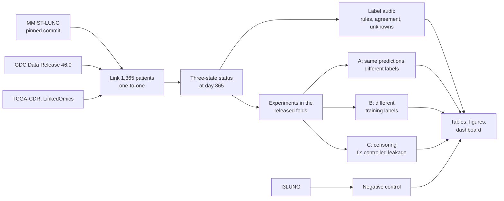

# When one survival label means two opposite things

**A source-linked audit of the 12-month labels in the MMIST-LUNG lung cancer benchmark, and what they do to machine-learning evaluation.**


[MMIST-LUNG](https://github.com/ritacmendes/MMIST-LUNG) is a public benchmark of 1,365 lung cancer patients from two cohorts, TCGA and CPTAC. One of its headline tasks is to predict who survives 12 months.

This project traced every one of those labels back to the patient's upstream clinical record. In TCGA, every label that could be checked agreed. In CPTAC:

- **All 62 patients labelled as dying within a year were alive at day 365.** They died later.
- **All 26 patients who died within a year were labelled as survivors.**

> **Read this first.** This audits a benchmark's labels. It is not a clinical tool and has not been peer reviewed. The authors' published results were not re-run, so nothing here says those numbers are wrong by a specific amount. "Source" means the upstream Genomic Data Commons (GDC) record, which is not adjudicated clinical truth. MMIST-LUNG is a valuable, openly shared resource, and that openness is what made this audit possible.

## The question

**How do the released 12-month labels compare with outcomes derived from the linked source records, and does the choice of label change how models are judged on the same patients?**

## The story in six charts

### 1. A simple check turns up a problem in one cohort

Each patient's released label was compared with their status at day 365 in GDC Data Release 46.0. All 1,365 patients linked one-to-one.


Across all patients, **88 of 1,154 checkable labels (7.6%) contradict the source**, and all 88 are in CPTAC. Another **211 patients (15.5%) have a 12-month status nobody can know from the record**, for example because they were last seen alive before day 365. All 211 were released as survivors.

### 2. The cause: two labelling rules with opposite polarity

Plotting the released label against the recorded day of death makes the pattern obvious.


Two rules reproduce every released label exactly:

| Cohort | A patient is labelled a survivor if | Labels reproduced |
|---|---|---|
| TCGA | death **after** day 365, or no death recorded | 1,026 of 1,026 |
| CPTAC | death **on or before** day 365, or no death recorded | 339 of 339 |

The CPTAC rule is the one printed in the authors' [encoding notebook](https://github.com/ritacmendes/MMIST-LUNG/blob/430670cebcbfa26fbb80a5812dc55e3e6c7da3ed/encode-csv.ipynb), which they describe as a guide rather than something meant to run:

```python
dem_df['vital_status_12'] = np.where((death_days <= 365) | (death_days.isna()), 1, 0)
```

The pattern looks like an encoding slip, but that has not been confirmed with the authors. Both rules also treat "no recorded death" as survival, however short the follow-up.

### 3. Why the headline number does not reveal it

The benchmark reports that 86% of patients survive beyond 12 months. A Kaplan–Meier estimate from the source records gives 86.8% (95% CI 84.7–88.5). Those look consistent, but only because errors in opposite directions offset.


Cross-validation cannot catch this either. The benchmark's folds are stratified on the same label, and training and test patients share it, so a model is simply marked against the rule it was trained on.

### 4. The labels flip which cohort looks riskier, and models learn the flip

Here is what connects a labelling problem to machine learning. Under released labels, CPTAC looks like the higher-risk cohort. Under source labels, it is the lower-risk one.


The 15 clinical features identify a patient's cohort perfectly (out-of-fold AUROC 1.000), so a model can learn whichever ordering it is shown. A stage-only model cannot see the cohort, and it predicts the same average risk for both.

### 5. The benchmark would reward the model trained on the inverted labels

Train the same model on each label set, then judge both models under each label set. The lines cross.


Training on source labels improves AUROC against those labels by about 0.05, and the gain appeared in all 50 repeats of cross-validation. Anyone selecting models with the released labels would conclude the opposite.

### 6. The honest part: the pre-specified test was weak

Before fitting any model, the main test was fixed: hold predictions constant and compare AUROC against each label set on identical patients. The result is small, and it does not hold up everywhere.


So the evidence does **not** support saying that the released labels clearly inflate scores for a fixed model. The stronger machine-learning results (charts 4 and 5) came from analyses added after seeing the data, and they need confirming. Correcting how the fold file was aligned also moved the primary estimate from −0.042 to −0.034, a further reason for caution ([changelog](docs/changelog.md)).

## How much weight each finding can carry

| Finding | Evidence | Strength |
|---|---|---|
| Released label follows opposite-polarity rules by cohort | Exact reproduction of all 1,365 labels | **Deterministic** |
| Unknown 12-month outcomes released as survivors | 211 patients, counted from source records | **Deterministic** |
| Labels reverse the apparent cohort risk, and models learn it | Direct rates; mean predictions by cohort | Strong, post-hoc |
| Training on source labels improves true-label AUROC | +0.049 (95% CI 0.015 to 0.082), logistic | Moderate to strong, post-hoc |
| Label set shifts the gap between the 15-feature and stage-only models | +0.060 (95% CI 0.026 to 0.098), logistic | Moderate, post-hoc |
| Label set changes AUROC for fixed predictions | −0.034 (95% CI −0.068 to −0.003) | **Weak**, pre-specified |

## Did the audit just find what it wanted to find?

Several checks were built in to guard against that.

- **Negative control.** The same audit on the independent [I3LUNG](https://doi.org/10.1038/s41591-026-04488-2) dataset finds its 6-month label consistent for 1,972 of 1,972 patients and its 24-month label for 1,699 of 1,699. Patients censored before the horizon are correctly left blank. This is not external validation of any model here.
- **Reproduction first.** All 35 numbers from the feasibility stage were reproduced from freshly downloaded data before anything was changed.
- **Independent releases.** TCGA-CDR and LinkedOmics agree with GDC on 365-day status for 1,070 of 1,071 patients with status known in both. They share upstream submissions, so this shows consistency, not independent truth.
- **Falsification checks.** Shuffled labels give an AUROC of 0.500. Flipping CPTAC's recorded-death labels recovers the source status in 88 of 88 cases, excluding one record changed upstream.
- **Fold reconstruction.** `folds.npy` is regenerated exactly, which is how the alignment error above was found.

## If you use this benchmark

For the 12-month task, derive the outcome from GDC time and event fields, and keep a third state instead of forcing every patient into two classes:

| Status at day 365 | Rule |
|---|---|
| Early death | Recorded death on or before day 365 |
| Alive beyond 12 months | Death after day 365, or last seen alive on or after day 365 |
| **Unknown** | Everything else. Do not count these patients as survivors. |

The released files have no follow-up time for CPTAC patients without a recorded death, so GDC is needed to recover it. `src/derive_outcomes.py` implements these rules, with tests for each boundary case.

`vital_status_dss` also needs care: it is 1 for every CPTAC patient, including the 42 whose GDC cause of death is "Cancer Related", so CPTAC contributes no events to the disease-specific task.

## What this does not show

- That the published benchmark numbers are wrong by any specific amount. The models here are declared surrogates: logistic regression and gradient boosting on the same 15 features and folds.
- That the 15-feature models are better or worse than stage alone. Within each label set, those comparisons are unresolved.
- That the authors used any leaked predictors. The controlled leakage experiment in this repository is hypothetical.
- Anything about clinical utility, deployment, or any other patient population.

## Closest prior work

| Work | What it did | How this differs |
|---|---|---|
| [Mendes et al. 2026](https://arxiv.org/abs/2609.05202) | Introduced MMIST-LUNG and its benchmarks | The benchmark audited here |
| [Tadj et al. 2026](https://doi.org/10.3390/biomedinformatics6040060) | Leakage and censoring audit in breast cancer prognosis | Different cancer. Here, the label's generating rule is reconstructed exactly. *Metadata checked; full text still to be read.* |
| [Northcutt et al. 2021](https://arxiv.org/abs/2103.14749) | Label errors in general ML test sets | Those errors are found statistically and look scattered; these are systematic and confined to one cohort |
| [Ahsan et al. 2026](https://neurips.cc/virtual/2026/162364) | Harmonising TCGA-LUAD data for ML | No audit of a released multi-cohort label. *Abstract only.* |

Searches found no earlier report of this issue, including in the benchmark's GitHub issues. The search was not systematic, so this is not a claim of priority. Full register: [`literature_register.csv`](outputs/tables/literature_register.csv).

## How it works



The [protocol](docs/protocol.md) was frozen before any model was fitted, though after the labels had been explored, so it is not a preregistration. Every later change is dated in the [changelog](docs/changelog.md).

## Explore the dashboard

An interactive Streamlit dashboard shows every result with its denominators. It runs from the committed aggregate tables, so it needs no data download.


## Run it

```bash
git clone https://github.com/Isaac25-lgtm/lung-cancer-ml-survival-audit.git
cd lung-cancer-ml-survival-audit
python -m venv .venv
# Windows:        .venv\Scripts\activate
# Linux / macOS:  source .venv/bin/activate
pip install -r requirements-lock.txt

streamlit run dashboard/app.py    # view the results straight away
python -m pytest                  # tests (those needing raw data skip until it is downloaded)
python -m src.run_analysis        # full reproduction; add --quick for 5 CV repeats
```

Requires Python 3.11 or 3.12. A full run takes about 15 minutes on a laptop CPU and downloads public data without credentials.

## Repository guide

| Path | Contents |
|---|---|
| [`docs/findings.md`](docs/findings.md) | Full report with every number and the decision gates |
| [`docs/manuscript_draft.md`](docs/manuscript_draft.md) | Draft abstract, outline, limitations and evidence ledger |
| [`docs/protocol.md`](docs/protocol.md), [`docs/changelog.md`](docs/changelog.md) | What was planned, and every deviation |
| [`docs/source_provenance.md`](docs/source_provenance.md) | Sources, versions, and what could not be verified |
| [`src/`](src) | Pipeline: download, linkage, outcomes, audit, experiments, figures |
| [`outputs/tables/`](outputs/tables) | Aggregate results, with no patient identifiers |
| [`outputs/figures/`](outputs/figures) | Publication figures in SVG, PDF and PNG, with [captions](outputs/figures/captions.md) |
| [`dashboard/`](dashboard), [`tests/`](tests) | Streamlit app and test suite |

## Data and credits

Raw and patient-level data are **not** in this repository. They are downloaded at runtime from their original hosts and pinned by SHA-256 in [`source_manifest.csv`](outputs/tables/source_manifest.csv). MMIST-LUNG has no licence file and I3LUNG is CC BY-NC 4.0, so only aggregates are published. See the [reuse notes](LICENSE_OR_REUSE_NOTES.md).

If you use this work, please also cite the original resources: MMIST-LUNG ([Cordeiro Mendes et al., arXiv:2609.05202](https://arxiv.org/abs/2609.05202)), the Genomic Data Commons, TCGA-CDR ([Liu et al., Cell 2018](https://doi.org/10.1016/j.cell.2018.02.052)) and I3LUNG ([Prelaj et al., Nature Medicine 2026](https://doi.org/10.1038/s41591-026-04488-2)).

Code: MIT licence. Author: Isaac Omoding.
